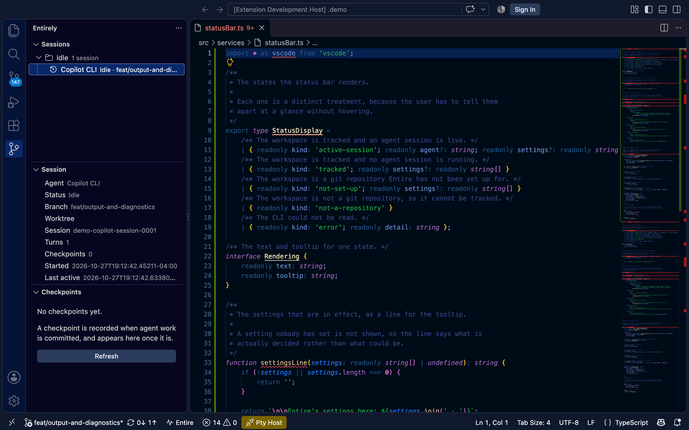
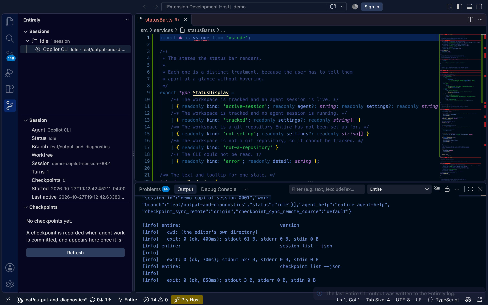

# Entirely


[](https://scorecard.dev/viewer/?uri=github.com/greysquirr3l/entirely-vscode)

A Visual Studio Code extension for [Entire](https://entire.com) — the Git
forge built for agent-human collaboration.

Entire records what coding agents did as **sessions**, freezes them into
**checkpoints**, and publishes that history so a team can see what every
agent did and why. The CLI does the work. Entirely is the editor-side
surface for it.

```
Entirely (this extension)
   └── entire CLI  (the source of truth — never re-implemented here)
         └── git refs, session state, the Entire API
```

## What it does

| Surface | What it shows |
|---|---|
| **Status bar** | Whether the workspace is tracked by Entire, and whether an agent session is live right now |
| **Entire view** | Every session Entire tracks for the repository — across all worktrees, not just the open folder |
| **Session detail** | The selected session in full, ended ones included: agent, model, tokens, files touched and tool calls, with the transcript opening in a read-only editor |
| **Session actions** | Stop, attach, adopt and resume a session from the palette or its context menu, each only when you ask |
| **Checkpoint history** | Recorded checkpoints, opening straight into the native diff editor |
| **Why this line** | Which agent edit introduced the line under the cursor, and why |
| **File blame** | `entire blame` for the active file: every line marked as attributed, recorded but not synced, or not attributed to any recorded change |
| **Account view** | Who the CLI is signed in as, and which jurisdiction the account belongs to — with sign-in and sign-out |
| **Hook bridge** | Reports the editor's own agent activity to Entire, so editor work lands in the same session history |
| **Terminal PATH repair** | Puts the Entire CLI on the integrated terminal's PATH, through the editor's own settings — no shell profile, no shell command |
| **BYOK models** | Works with whatever model Copilot Chat is using — hosted, BYOK, or local — without the extension knowing the model exists |
| **Doctor** | A copyable diagnostic report: CLI version, repository state, effective settings, last error |

The extension never re-implements Entire. It discovers the installed CLI,
reads its JSON output, and shells out for anything mutating. If the CLI is
missing, the extension degrades quietly rather than failing obscurely.

**Model-agnostic by construction.** No model name, provider or context-window
size is hardcoded anywhere. The model is an opaque string, recorded exactly
as the Copilot transcript reports it — so a BYOK model from any provider and
a local Ollama model work the same as a hosted one, and a model the
extension has never seen is not a special case.

## Status

**Version 0.1.0.** The extension talks to the Entire CLI and shows what it
knows: which repository is tracked, which agents are running, what each
session did, and why a line of code is the way it is. It compiles, lints and
passes its extension-host tests.

The command list and the setting names are still provisional. They are the
surface a user actually touches, so they are the most likely thing to change
in a later version.

## Screenshots

The sessions Entire tracks for the repository, with the details of the
selected one beside them:



Every CLI invocation the extension made, in the `Entire` output channel:



## Session detail and transcripts

Select a session and the Session view fills in from `entire session info`:
when it ended, its last checkpoint, the files it touched and how many times
each tool was called. A session that has ended is inspected the
same way as a live one.

Token usage comes from `entire session tokens` rather than from the counts in
`session info`, and an opened checkpoint shows a **Tokens** row from `entire
checkpoint tokens`. The extension shows what the CLI reports and nothing
else: it adds nothing up and estimates nothing. When the CLI reports no usage,
or leaves one count out, the row says **Not reported** instead of showing 0.
Usage in a shape the extension cannot read says **Not recognised**, and a
failed CLI call says **Not available**.
Model names appear exactly as the CLI sends them.

The transcript is not in the tree. **Transcript** in the Session view, or the
button on a session, opens it in a read-only editor beside its attribution
and a tool call summary. It is read from `entire session info --transcript`,
which streams the agent's own format; Claude Code, Cursor, Codex and Copilot
CLI transcripts are understood, and any other format is shown as raw text.
The editor holds the first 4 million characters, and the extension reads at
most 16 MB from the CLI, saying so when it cuts a transcript short.
`entirely.transcriptTimeout` sets how long to wait for the CLI.

The transcript is your own conversation with the agent, so it is never
written to the `Entire` output channel, not even at the debug level.

The filter button in the Sessions view narrows the tree to the session that
belongs to this workspace, using `entire session current`. A session the CLI
reports as belonging to another worktree is not offered.

## Stopping, attaching, adopting and resuming sessions

Right-click a session in the Sessions view, or use the palette (**Entirely: Stop
Session**, **Attach Session to a Commit**, **Adopt Session from Another Worktree**,
**Resume Session**). Nothing here runs unless you choose it, and none of it runs on
the refresh timer. Each command's flags are read from `entire agent-help session
<command>`; if the help is unreadable or lacks a flag, the action fails and says why.

- **Stop** asks first, naming the session (id, agent and branch), then runs
  `entire session stop`. Stopping ends capture and writes no checkpoint, so commit
  first if work is pending.
- **Attach** lets you pick the session (or type an id the view does not list) and
  the commit (default `HEAD`). The CLI first describes what it would do, including
  whether it would rewrite unpushed commits. That description is the confirmation
  you are shown, and only if you agree does the extension rerun it for real. The
  message that follows is the CLI's own account of what it linked.
- **Adopt** takes an active session from another worktree after you confirm it,
  then refreshes the tree and says whether the session is listed for this workspace.
- **Resume** runs `entire session resume <branch>` in an integrated terminal, because
  the CLI asks whether to start the agent. The extension cannot see your answer, so
  it does not assume the work started: it watches the session list for up to
  `entirely.resumeWatchTimeout` seconds and reports that the session is active
  again, or that none appeared (with the terminal's exit code if it had ended).

`entirely.lifecycleActionTimeout` sets how long stop, attach and adopt may take.

## Blaming a file

**Entirely: Blame This File** runs `entire blame` on the active file when you ask,
never on a timer or while you type. Each line gets a coloured bar and a short note:
purple for a recorded change (agent or commit), orange for a recorded change whose
checkpoint has not synced to this machine yet, and grey for a line with no recorded
change at all, which reads "Not attributed to any recorded change". The whole-file
answer opens in the same panel as **Why Does This Line Exist?**, drawn by the same
code, and the hover on a line links to that command, so the answer for a line is the
same either way.

The CLI blames the saved file, so a file with unsaved changes asks to be saved
first. Marks are removed when you edit the file (the line numbers would no longer
match) or run **Entirely: Clear Blame**. Files longer than
`entirely.blameMaxDecoratedLines` (default 5000) are blamed and shown in the panel
but not marked in the editor. `entire blame` is a labs command and the CLI may change
its output.

## Searching checkpoints

The search button in the Checkpoints view opens a box. As you type, the extension
runs `entire checkpoint search` and the tree narrows to the checkpoints it found.
The matching is the CLI's, never a local filter over the list, and the CLI needs
a login and a published repository. The extension reads the command's flags from
`entire agent-help checkpoint search` instead of keeping its own list.

The view says one of three things. It lists the matches. It says **No checkpoint
matched**, which means the search ran and found none. Or it says **The search
failed** and gives the reason, such as the CLI missing, too old to have the
command, or not signed in; a failed search never claims there were no matches.
The search returns commits and sessions too, and only checkpoints are listed; the
message counts the others. The clear button restores the full list.

`entirely.searchDebounce` sets how long to wait after you stop typing. Your query
stays in the editor: it is not written to the `Entire` output channel, and the
results are kept out of it too.

## The terminal PATH

The Entire CLI installs to `~/.local/bin`, which the integrated terminal
does not inherit. The extension itself is unaffected — it runs the CLI by
absolute path — but a terminal you open in the editor cannot run `entire`.

Entirely offers to fix that: **Entirely: Add the Entire CLI to the Terminal
PATH**. The repair is the editor's own terminal environment, so the only
thing that changes is a setting the editor already owns. No shell profile is
read or written, and no shell command is run.

You choose the scope, and each one says what it costs before you pick it:

| Scope | What it touches |
|---|---|
| This workspace folder | That folder's own settings file |
| This workspace | The workspace settings file — which may be committed |
| Your user settings | Every window you open; nothing in a repository changes |

The value written is `${env:PATH}` with the CLI's directory on the end. The
inherited PATH is a *reference*, not a copy, so the terminal takes the live
PATH rather than a snapshot of it taken when the setting was written.

Running the command again takes the directory off again.

## When something is not working

Everything the extension does goes to one output channel, named **Entire**.
Every call to the CLI is written there with the exact command line, the
directory it ran in, and the exit code — enough to reproduce a problem by
hand.

```
[info] entire: /usr/local/bin/entire status --json
[info]   cwd: /work/entirely
[info]   exit: 0 (ok, 14ms); stdout 1.2 kB, stderr 0 B, stdin 0 B
```

Prompt bodies and checkpoint payloads are **not** written there. The channel
says how many bytes there were, and the content itself is behind
**Entirely: Doctor: Show the Last Entire CLI Output**, for the times when
you really do want to read it.

**Entirely: Doctor: Copy a Diagnostic Report** answers "why is this not
working?". It reports the CLI's path, version and location; whether the
workspace is a git repository and whether Entire is enabled for it; the
settings in effect; and the last error the CLI gave. The report is one
block of text and one action to copy it, because it is usually on its way
into an issue.

Turn the volume up with `entirely.debug`, or with `entirely.logLevel` for
finer control. There is still only one channel.

## Two Entire accounts

If you have more than one Entire login, the status bar tooltip says which one
the extension is acting as, the Account view says the same thing, and the
doctor report counts the saved logins.

`entirely.cliContext` pins one of them for the extension. The name is the one
`entire auth contexts` prints — `us.auth.entire.io`, or
`handle@us.auth.entire.io` for a second identity on a host that already has
one. Leave it empty and the extension follows the login the CLI is using on
its own.

The pin changes what the extension does. The CLI keeps the login it would have
used in your terminal, and a workspace the pinned login cannot see is said to
be invisible to that login rather than to be untracked.

## Signing in and out

The Account view reads `entire auth status --json` and shows the handle the
CLI is signed in as and the jurisdiction of the account — the country whose
law the account falls under, which is not always the country you are in. When
nobody is signed in, the view says so and offers to sign in; when the CLI
could not be asked, it says it does not know, rather than claiming that nobody
is signed in.

**Sign In to Entire** uses the CLI's device-code flow, so it works on a
machine with no graphical display, where the browser redirect has nowhere to
open. The code you have to type is shown in a panel while the command waits,
because the command does not finish until you approve it.

**Sign Out of Entire** says what it is about to do before it does it: every
login saved on this machine is signed out, not only the one in use, and every
CLI session on the login server ends too. The CLI will not narrow that, and
the extension does not pretend otherwise.

The extension never reads the credential store — the keychain, the secret
service, or the file-backed fallback — and never asks the CLI for a
credential. What it shows you is where the credentials are kept, not the
credentials themselves.

## Requirements

* The [Entire CLI](https://docs.entire.com/installation) — `entire version`
  must run. Without it the extension stays dormant.
* VS Code 1.140 or newer.

## Maintaining

Opening a pull request here has two rules that are not obvious, and both
cost a day the first time they were met:

1. **Open the pull request as the author of the commits.** The `main`
   ruleset asks for an approval from an account that is neither the pull
   request's author nor the commit's author when the two differ, and a
   pull request's author cannot approve their own pull request.
2. **Expect the Entire gate to end `neutral`,** which GitHub treats as
   passing. `failure` blocks the merge.

The reasoning, the timeline and everything else that was learned the hard
way is in
[docs/post-mortem-entire-gates.md](docs/post-mortem-entire-gates.md).

## Development

```sh
npm install
npm run compile     # type check, lint, bundle
npm test            # extension-host tests
npm run watch       # rebuild on change
```

### Tests

The extension-host tests live in `src/test/` and run inside a real VS Code
extension host. The runner is [`@vscode/test-cli`](https://github.com/microsoft/vscode-test-cli),
configured by `.vscode-test.mjs`:

```sh
npm run compile-tests   # compile the tests to out/
npm test                # run them in a headless extension host
```

Install the
[VS Code Extension Test Runner](https://marketplace.visualstudio.com/items?itemName=ms-vscode.extension-test-runner)
to run the same suite from inside the editor. It reads the same
`.vscode-test.mjs`, discovers the compiled test files under `out/test/`, and
runs them in a debuggable Extension Development Host — so failures land in the
Testing view with source-mapped stack traces instead of in a terminal.

The runner executes the compiled JavaScript, not the TypeScript sources, so
compile the tests first — `npm run compile-tests`, or keep `npm run watch-tests`
running in the background.

No extra configuration is needed: `sourceMap` is on in `tsconfig.json` and
`.vscodeignore` excludes `**/*.map`, so stack traces point back at the
original TypeScript. On a remote without a display, set
`extension-test-runner.wrapper` to `xvfb-run`.

### Releasing

A release is a tag. Push `v0.1.0` and the `Release` workflow builds the
package, checks what is in it, publishes it to the Visual Studio Marketplace
and to Open VSX, and then makes a GitHub release with the `.vsix` attached.
A tag whose version does not match `package.json` stops the build rather
than publishing the wrong version.

Two repository secrets are needed:

| Secret | What it is |
|---|---|
| `VSCE_PAT` | A personal access token for the Marketplace publisher |
| `OVSX_PAT` | A personal access token for the Open VSX namespace |

The workflow can also be run by hand from the Actions tab. Leave the version
empty to build the version in the manifest, and leave **Publish** off to
build and check the package without publishing it — a dry run.

The `marketplace` and `openvsx` jobs use GitHub environments, so either
one can be made to wait for a review before it publishes.

## Licence

MIT

## Issues

Found something broken, or want to see something built? The repository and
issue tracker live at
[greysquirr3l/entirely-vscode](https://github.com/greysquirr3l/entirely-vscode).
